# Smart Writing Pad

### Smart Writing Pen & Digital Learning Pad for Children with Specific Learning Disabilities

An accessible, local-first handwriting practice application for children who find writing
difficult. Children trace letters, numbers and short words on a digital writing pad using a
mouse, a finger or a stylus, and teachers or parents can review the work afterwards.

> **This is a practice tool, not a medical device.** It does not diagnose, screen for or treat
> any learning disability, and it does not assess handwriting quality. Every figure it reports
> is either a count of what was done or a geometric measurement of ink against a printed guide.
> See [What the app measures](#what-the-app-measures-and-what-it-does-not).

---

## Problem statement

> "Developing writing pen and writing pad for children with Specific learning disability."

Children with specific learning difficulties affecting writing often struggle with letter
formation, consistent spacing, staying on the line, stroke sequencing and independent practice,
and they rarely get structured feedback or a visible record of what they have practised.

## Project overview

Smart Writing Pad is a browser application that provides:

- a **digital writing surface** that behaves the same for a mouse, a touchscreen and a stylus;
- **guided tracing** for A–Z, a–z, 0–9 and sixteen short words, with numbered start dots,
  direction arrows and ruled writing lines;
- **four learning modes** — free writing, tracing, independent practice, and progress review;
- **accessibility settings** (letter size, contrast, guide visibility, larger controls, reduced
  distractions, spoken instructions) that persist between sessions;
- **honest progress tracking** — what was attempted, when, and how much of each printed shape
  was covered — with no fabricated scores;
- a **teacher/parent review screen** with saved writing samples and CSV/text exports.

Everything runs in the browser. There is no account, no server and no upload.

## Target users

| User | What they use it for |
| --- | --- |
| Children (roughly ages 5–11) who find writing difficult | Tracing and practising letters, numbers and words at their own pace |
| Teachers and special educators | Setting practice, reviewing saved samples, spotting characters that need more work |
| Parents | Supporting practice at home and keeping a record of it |

## Features

### 1. Interactive digital writing pad
Write with a mouse, finger or stylus; six pen colours; adjustable thickness (2–24); eraser that
removes whole strokes; undo and redo; clear; save a sample into the app; download the sheet as a
PNG. Input is handled with **Pointer Events**, so one code path serves every device.

### 2. Guided letter tracing
Uppercase A–Z, lowercase a–z, digits 0–9 and sixteen short words. Each character is stored as an
ordered set of strokes, which gives the app a path to trace, a numbered start dot, a direction
arrow per stroke and a spoken hint — all generated from the same data, so they can never
disagree. Tracing difficulty (how close the ink must stay) is adjustable.

### 3. Learning modes
- **Free writing** — a blank ruled pad with the full toolbar.
- **Tracing** — follow the printed path, then measure the result.
- **Practice** — the example is shown beside a blank sheet; the child reproduces it unaided.
  Nothing is measured here, because the child chooses where on the sheet to write.
- **Progress** — what has been practised and when.

### 4. Adaptive accessibility settings
Letter size (0.6×–1.8×), high-contrast mode, reduced visual distractions, guide visibility
(clear / faded / hidden), start dots and arrows on or off, ruled lines on or off, larger buttons,
and optional spoken instructions via the Web Speech API. All settings are saved on the device and
apply across every exercise. The interface uses **Atkinson Hyperlegible**, a typeface designed for
maximum character distinction.

### 5. Student progress dashboard
Exercises attempted, traces that met the target, practice sessions, distinct characters tried,
writing samples saved, a 14-day activity chart, and a per-character table with the best coverage
recorded. Everything persists across reloads.

### 6. Teacher / parent review
Saved writing samples with full-size preview, delete and download; the complete practice log;
a "worth revisiting" list; a flag for characters needing more work; and exports as CSV
(full log) or plain text (summary). Profiles are anonymous — just an optional device nickname.

## What the app measures, and what it does not

When a child presses **Check my tracing**, the app compares the ink they drew against the printed
guide, in the same coordinate system, and reports two numbers:

| Measure | Meaning | Passing target |
| --- | --- | --- |
| **Shape covered by your ink** | Share of guide sample points with ink within the tolerance | ≥ 75% |
| **Your ink that stayed on the shape** | Share of ink sample points within the tolerance of the guide | ≥ 60% |

Both sides are resampled to a fixed spacing first, so the result does not depend on how fast the
child moved the pen. **Both** thresholds must be met for an attempt to count as complete — an
untouched letter fails the first, and scribbling over the whole sheet fails the second. The
tolerance comes from the difficulty setting (easy 22, medium 15, precise 10 design units).

The app deliberately does **not** claim to do handwriting recognition, does not grade handwriting
quality, and does not report improvement percentages or learning outcomes. Practice-mode and
free-writing attempts are recorded as attempts and explicitly labelled "not measured".

## Technology stack

| Layer | Choice | Why |
| --- | --- | --- |
| UI | React 19 + TypeScript | Component model, type safety across the geometry code |
| Build | Vite 8 | Fast dev server, small static production build |
| Styling | Tailwind CSS 4 + CSS custom properties | Theming (incl. high contrast) without a second system |
| Drawing | HTML Canvas 2D + Pointer Events | One input path for mouse, touch and stylus |
| Guides | Inline SVG | Crisp at any size, cannot be erased by the child |
| Storage | localStorage + IndexedDB | Settings/log are small; PNG samples need IndexedDB |
| Routing | React Router (hash) | Works on any static host and from `file://` with no rewrites |
| Unit tests | Vitest + jsdom + fake-indexeddb | Pure logic tested without a browser |
| E2E tests | Playwright (Chromium, desktop + Pixel 5) | Real drawing, persistence and layout checks |

No backend, no authentication and no AI API — none of them are needed for the MVP, and each
would add failure modes without adding capability.

## Architecture overview

```
src/
├── lib/                 Pure logic — no React, fully unit tested
│   ├── geometry.ts      Points, lines, arcs, resampling, distance
│   ├── glyphs.ts        Stroke data for A–Z, a–z, 0–9 + word layout
│   ├── layout.ts        Fits design coordinates onto a writing sheet
│   ├── scoring.ts       Tracing coverage measurement
│   ├── render.ts        Canvas drawing + PNG export
│   ├── stats.ts         Dashboard figures derived from the attempt log
│   ├── storage.ts       localStorage (settings, attempts) with validation
│   ├── samples.ts       IndexedDB (writing samples)
│   ├── speech.ts        Web Speech API wrapper
│   └── download.ts      File download helpers
├── components/          WritingCanvas, GuideLayer, WritingSheet, Toolbar, …
├── pages/               One file per screen
└── state/AppProvider.tsx  Settings + attempt log, persisted on write
```

Full detail in [docs/ARCHITECTURE.md](docs/ARCHITECTURE.md).

## Setup

**Requirements:** Node.js 20 or newer (developed on Node 26) and npm.

```bash
git clone <your-repository-url>
cd smart-writing-pad
npm install
```

## Running locally

```bash
npm run dev
```

Then open the URL printed in the terminal (usually `http://localhost:5173`).

Other commands:

```bash
npm run build       # production build into dist/
npm run preview     # serve the production build on http://localhost:4173
npm run typecheck   # TypeScript, no emit
npm test            # unit tests (Vitest)
npm run test:e2e    # end-to-end tests (Playwright)
npm run screenshots # regenerate docs/screenshots from the running app
```

Before the first end-to-end run, install the browser Playwright drives:

```bash
npx playwright install chromium
```

## How to use each feature

| Screen | How to use it |
| --- | --- |
| **Home** | Overview, optional device nickname, links into every activity |
| **Writing Pad** | Draw freely. Pick a colour and thickness, erase, undo/redo, clear, save or download |
| **Letters** | Choose A–Z or a–z, pick a letter, start on the orange dot, follow the arrow, press **Check my tracing** |
| **Numbers** | The same for 0–9 |
| **Words** | The same for short words, on ruled lines that show letter height and spacing |
| **Practice** | Look at the example, write it on the blank sheet, then save the attempt and rate how it felt |
| **Progress** | Counts, 14-day activity, per-character table, CSV export |
| **Review** | Saved samples, full practice log, flags, summary and CSV exports |
| **Settings** | Letter size, pen defaults, guide visibility, difficulty, contrast, larger buttons, speech, delete all data |

## Screenshots

All images are real screens of the running application, captured by
`npm run screenshots`; no mock-ups.

| | |
| --- | --- |
| **Home** | **Writing pad** |
| 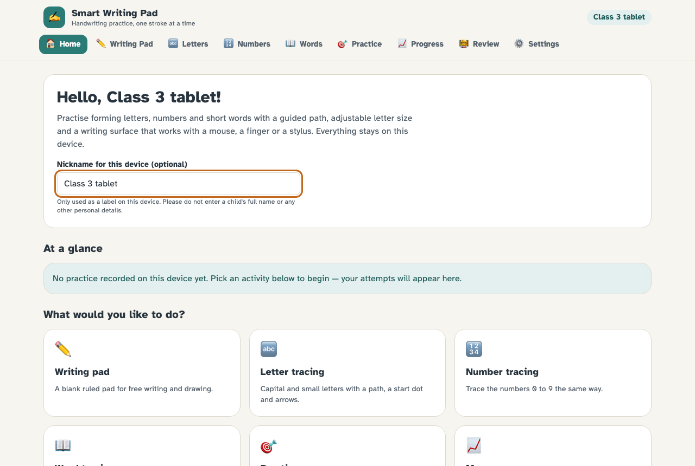 | 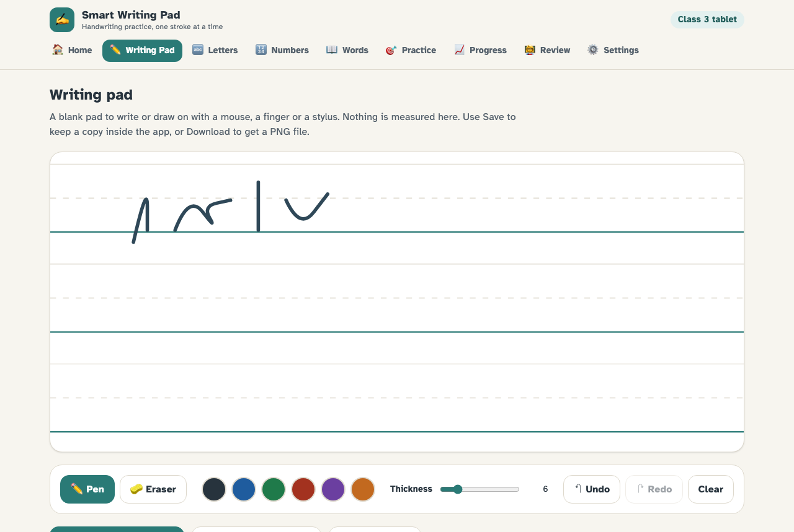 |
| **Letter tracing** | **A measured attempt** |
| 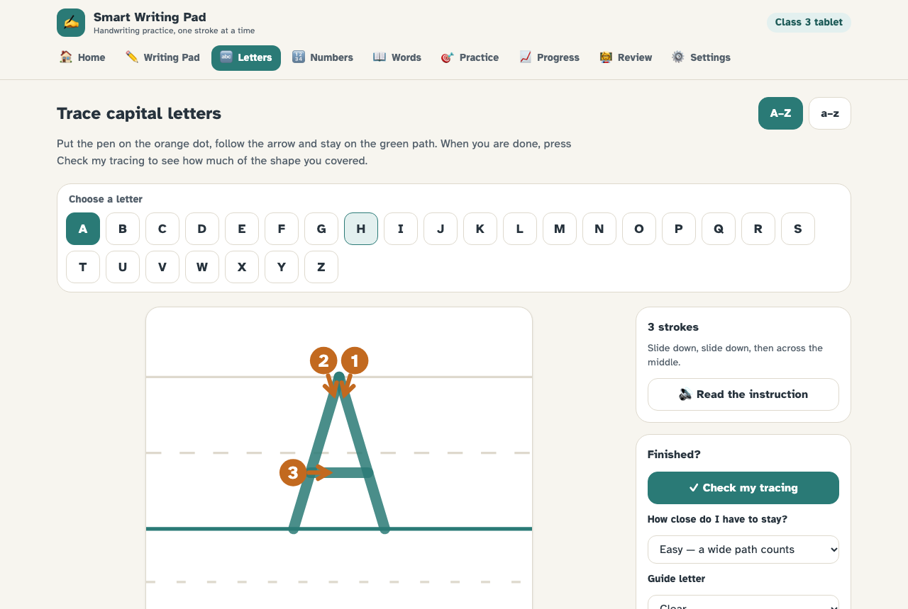 | 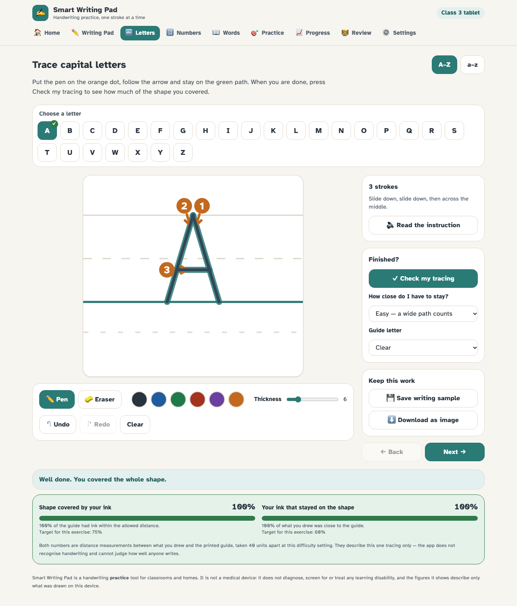 |
| **Number tracing** | **Word tracing** |
| 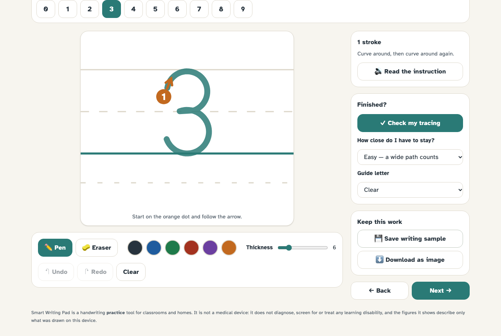 | 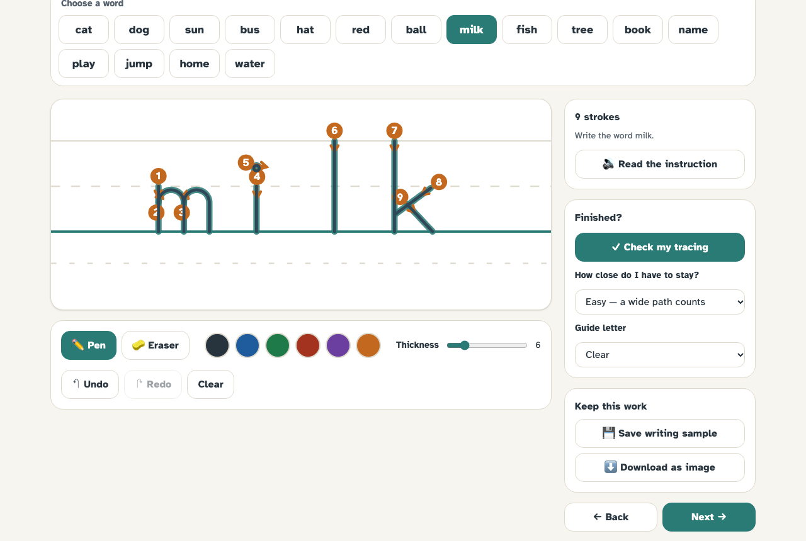 |
| **Practice mode** | **Progress dashboard** |
| 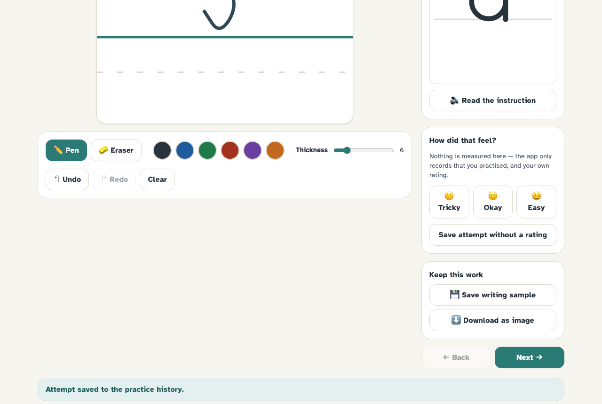 | 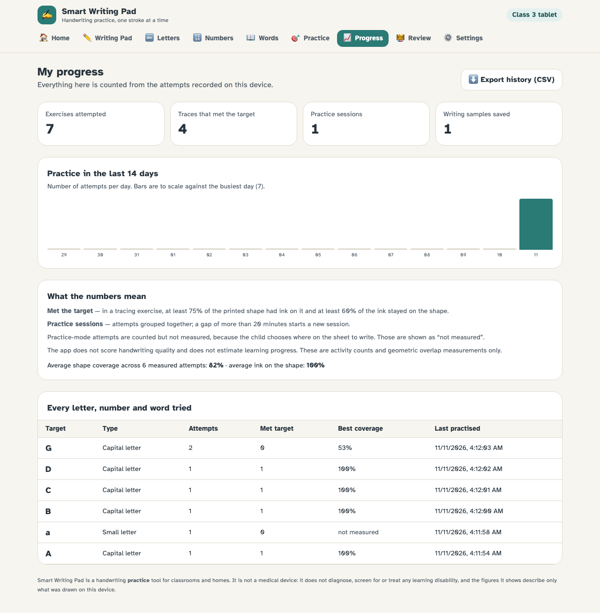 |
| **Teacher / parent review** | **Accessibility settings** |
| 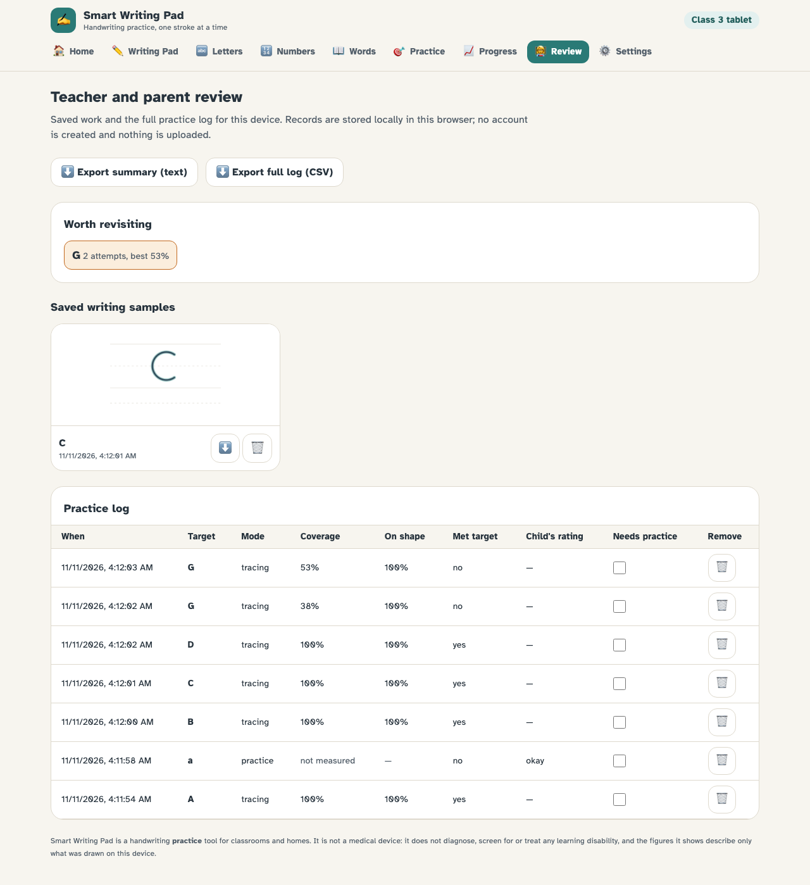 | 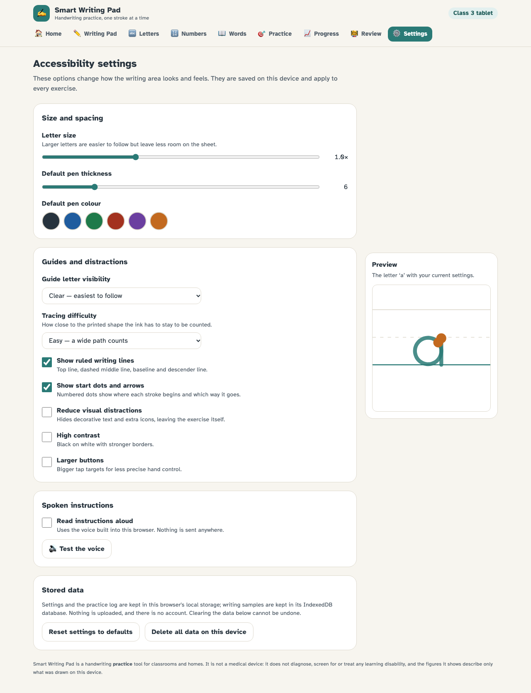 |
| **High contrast + larger buttons** | **Mobile layout** |
| 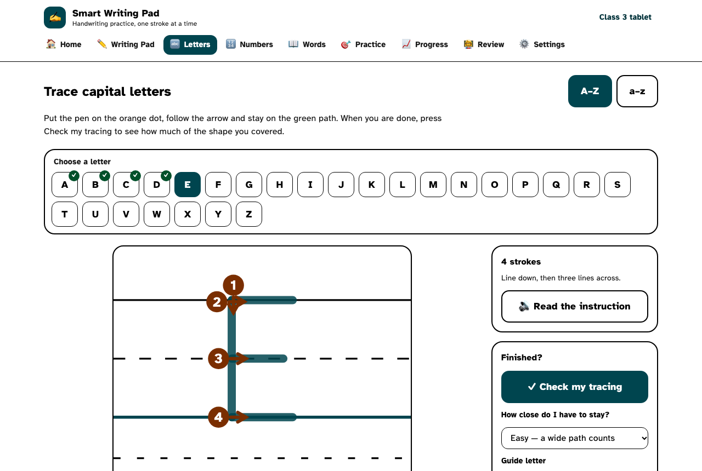 | 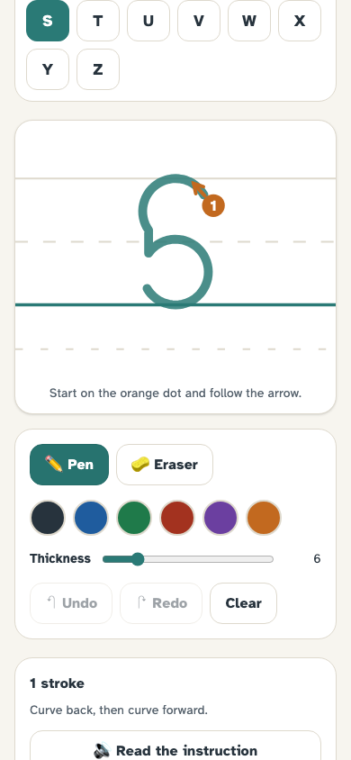 |

Close-ups of individual letter guides are in [`docs/screenshots/glyphs/`](docs/screenshots/glyphs).

## Testing

```bash
npm test          # 145 unit tests across 8 files
npm run test:e2e  # 58 end-to-end tests (29 desktop + 29 mobile)
```

**Unit tests** cover the geometry helpers, every glyph in the font (shape bounds, stroke count,
direction, writing-line placement), the sheet layout maths, the coverage scorer (including that
scribbling fails and that the result is speed-independent), stroke-marker placement, the stats
and CSV export, localStorage validation, and IndexedDB sample storage with its pruning cap.

**End-to-end tests** drive a real browser: they read the guide paths out of the rendered SVG and
trace them with the mouse, then assert on the measured result; they check undo/redo/erase,
persistence across reloads, PNG and CSV downloads, accessibility settings taking effect and
surviving a reload, deletion of all data, and that no screen scrolls sideways on a phone-sized
viewport. The same suite runs at desktop and Pixel 5 sizes.

Latest run on this machine: **145/145 unit tests and 58/58 end-to-end tests passing**;
`npm run build` succeeds with no TypeScript errors.

## Known limitations

- **Coverage is not handwriting recognition.** A child could trace the shape neatly in the wrong
  stroke order, or with many short strokes, and still score highly. Stroke order is taught and
  displayed but is not currently checked.
- **Practice and free-writing attempts are unmeasured** by design, so the dashboards show them
  as counts only.
- **Letter shapes are a single hand-authored print style.** There is no cursive, no joined
  writing and no alternative regional letterforms (for example a single-storey `a`).
- **Storage is per-browser, per-device.** Clearing site data removes everything; there is no sync
  between devices and no multi-child profiles beyond one device nickname.
- **Sample storage is capped** at the 60 most recent images and the log at 500 attempts, to stay
  inside browser quotas. Older records are pruned automatically.
- **Spoken instructions depend on the browser.** Where the Web Speech API is missing the option
  is hidden; voice quality varies between platforms.
- **Tested in Chromium only** (desktop and emulated Pixel 5). It should work in Safari and
  Firefox, which support every API used, but that has not been verified here.
- **No physical pen or pad hardware exists.** The project is software; see
  [docs/HARDWARE_EXTENSION.md](docs/HARDWARE_EXTENSION.md) for how it could be connected.

## Future enhancements

- Stroke-order and direction checking, with feedback on the specific stroke that went wrong
- Multiple child profiles on one device, with an export/import file
- Cursive and joined-writing guides; alternative letterforms
- A validated handwriting-quality measure, developed and tested with special educators
- Optional backend for syncing across devices in a classroom
- Stylus pressure and tilt, where the hardware exposes them
- Offline installability (PWA) for tablets with unreliable connectivity

## Team

| Role | Name | Contribution |
| --- | --- | --- |
| Team member 1 | _your name_ | _e.g. canvas and tracing engine_ |
| Team member 2 | _name_ | _e.g. accessibility and settings_ |
| Team member 3 | _name_ | _e.g. progress, review and documentation_ |

**Course:** Application Development · **Project type:** Major project · **Team size:** 3

## Further documentation

- [docs/ARCHITECTURE.md](docs/ARCHITECTURE.md) — components, state, canvas, persistence, decisions
- [docs/PROJECT_REPORT.md](docs/PROJECT_REPORT.md) — full academic report
- [docs/HARDWARE_EXTENSION.md](docs/HARDWARE_EXTENSION.md) — proposed pen/pad hardware (not built)
- [docs/DEMO_GUIDE.md](docs/DEMO_GUIDE.md) — demonstration script and viva questions
- [docs/AI_DEVELOPMENT_LOG.md](docs/AI_DEVELOPMENT_LOG.md) — record of AI-assisted development

## Licence

MIT — see [LICENSE](LICENSE).
